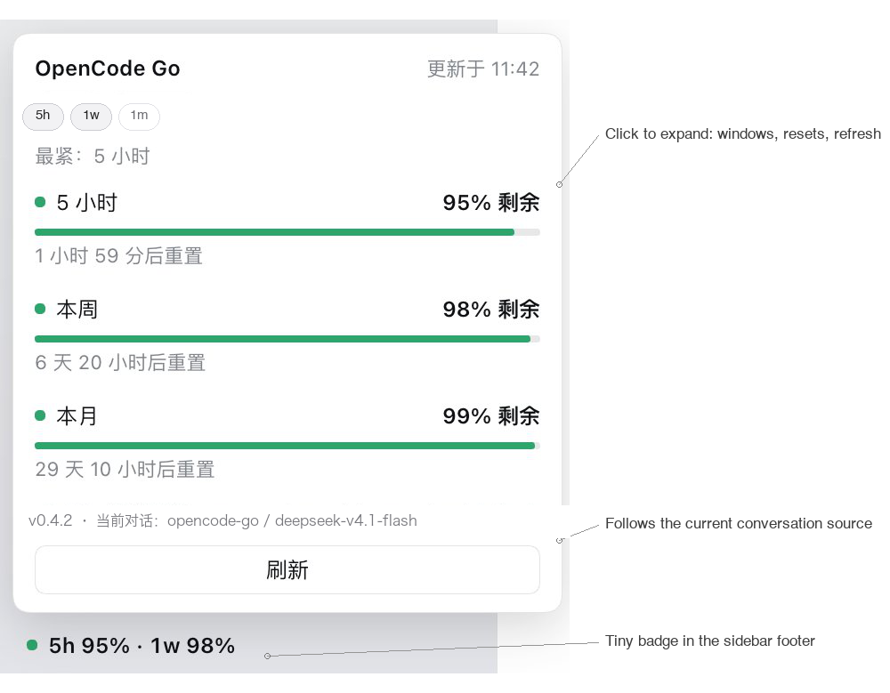

# dsh-opencode-go-usage-badge

A quiet, unobtrusive one-line DSH badge: see your OpenCode Go quota; when the conversation switches to a DeepSeek official model, it shows the balance instead. No setup; it just runs quietly.

[中文说明](https://github.com/Panther-w/dsh-opencode-go-usage-badge/blob/main/README.md) | English



Screenshots show the Chinese UI; the English README describes the same interface.

## What it is for

OpenCode Go has three quota windows (5-hour rolling, weekly, monthly) that block independently. The monthly number is usually not what stops you, so the badge shows the **5-hour** window by default; you can choose which windows to show, while the status colour always follows the tightest one. Quota and balance also come from different places, so the badge **follows the current conversation's model source** instead of asking you to configure it.

Three design rules keep it small:

- **Small and out of the way.** One line in the sidebar footer; nothing else in the layout changes.
- **Source-aware.** OpenCode Go conversation → quota. DeepSeek official conversation → balance. Unknown provider → `额度 —`, never a guess.
- **Simple and safe.** Read-only, no telemetry, no files written; keys stay in the DSH Host process.

## What you see

- Collapsed: the windows you selected, in a fixed order — `● 5h 95%`, `● 5h 95% · 1w 98%`, and so on.
- Tick any of `5h` / `1w` / `1m` in the expanded card. At least one stays selected; the default is `5h`, and the choice is remembered.
- The status dot always uses the tightest of all three windows, even when you hide it. If a hidden window is tighter than everything shown, the badge adds an amber `!` naming it in its tooltip.
- Colors: **above 20% green, above 5% and up to 20% yellow, 5% and below red**; 0% is red. Normal numbers stay in the theme text color; at 20% or below the number itself turns yellow/red, not just the dot.
- DeepSeek official conversation: `● ¥88.00`; the card shows total, recharge and bonus balances, the data source and the current model. A zero or negative balance is red.
- Unknown provider: `额度 —` in grey — never a guessed number.
- Data older than 5 minutes gets a `!`. A failed request keeps the last successful value for that source; missing or rejected credentials clear it.
- Refresh every 60 seconds while the page is visible, immediately on focus/visibility/`pageshow`/network recovery, and when the conversation's model source changes. The refresh button bypasses the 30-second cache.

## Where the data comes from

The badge reads the main-view conversation through DSH's `uiSession` service and its `modelSelection` projection (falling back to the session list). It never changes your model, thinking level or settings.

| Provider id | Data shown | Requirement |
| --- | --- | --- |
| `opencode-go` | OpenCode Go quota windows | `OPENCODE_GO_API_KEY` configured in DSH, or an OpenCode Console sign-in |
| `deepseek-account` | DeepSeek account balance | signed in under DSH **Settings → Account & balance** |
| `deepseek-official` | DeepSeek API-key balance | `DEEPSEEK_API_KEY` configured in DSH |

Only these built-in provider ids are recognized. Custom provider aliases or rewritten endpoints are not supported and show `额度 —`.

## Install

Tested with **DeepSeek Harness Desktop `0.2.2-rc.1` on macOS**.

1. Download `dsh-opencode-go-usage-badge-0.4.3.tgz` from the release, or clone this repository.
2. In DSH Desktop open **Plugins → Add plugin** and enter the tarball path, the repository URL, or the absolute path of this package. Enable the bundle after installation.
3. Fully quit and reopen DSH Desktop. Open a conversation using one of the providers above and check the bottom-left sidebar.

With the DSH CLI (npm, tarball, or repository URL):

```sh
dsh plugin --profile desktop add /path/to/dsh-opencode-go-usage-badge-0.4.3.tgz
dsh plugin --profile desktop add dsh-opencode-go-usage-badge
dsh plugin --profile desktop add https://github.com/Panther-w/dsh-opencode-go-usage-badge
```

Uninstall through the same Plugins page, then reopen Desktop.

## Privacy and security

- Read-only. The browser only calls three same-origin loopback routes on the DSH host.
- When no Go API key is configured, the Host reads OpenCode Console's local credential file (`credential.json`) as a Console credential (OAuth/key) fallback; the token stays in the Host and never reaches the browser.
- API keys and account tokens stay in the Host process; they never reach the browser and are not written to disk by this plugin.
- It talks only to `opencode.ai` (usage), `api.deepseek.com` (API-key balance), or the DSH account service (signed-in balance).
- No telemetry, no diagnostics upload, no files written. The display mode is stored in the browser's `localStorage`.
- Upstream answers are cached for 30 seconds; the card's refresh button bypasses that cache.

## Limitations

- Only the three built-in provider ids above are supported. Other providers show `额度 —`.
- Rewritten provider endpoints or custom credential names are not recognized.
- The OpenCode Go usage and DeepSeek balance endpoints are not stable public contracts; they may change.
- The plugin depends on DSH internal services and projection fields. A DSH upgrade may require an update.
- Windows and Linux have not been manually tested. Automated tests run on all three platforms in CI; please report platform issues.
- The OpenCode Console fallback depends on its local credential path and format (`~/.local/share/opencode-console/credential.json`; the same `~` layout on Windows, or `XDG_DATA_HOME`); a Console format change needs an update here.

## Development

```sh
node --check lib/index.js && node --check lib/client.js
node --test test/display.test.mjs test/host.test.mjs
npm pack --dry-run
```

## License

MIT. See [LICENSE](https://github.com/Panther-w/dsh-opencode-go-usage-badge/blob/main/LICENSE).
