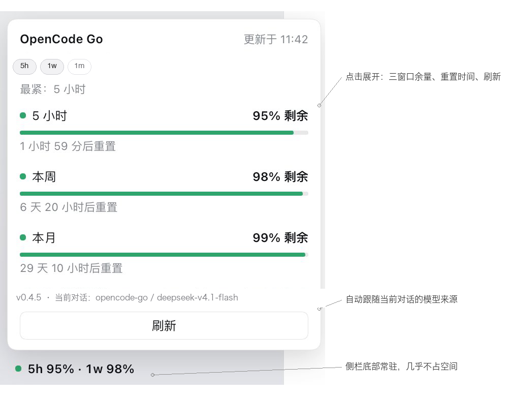

# dsh-opencode-go-usage-badge

中文 | [English](README.en.md)

DeepSeek Harness 侧栏底部的一个很轻的小徽标：显示当前 **OpenCode Go** 还剩多少额度；当当前对话使用 **DeepSeek 官方**模型时，它切换成对应的**余额**显示。

没有设置页、不改布局、不后台写文件——只是侧栏底部一个可以顺手扫一眼的小数字。



## 它是干嘛的

OpenCode Go 的三个额度窗口（5 小时滚动 / 本周 / 本月）各自独立阻塞。真正卡住你的通常不是"月剩余"，所以徽标默认显示 5 小时窗口，也可以自己勾选要看的窗口；状态点始终按最紧窗口上色。额度与余额又来自不同地方，所以徽标**自动跟随当前对话的模型来源**，不需要你手动配置。你可以选择显示哪些窗口，但状态点颜色始终反映最紧窗口——隐藏窗口不会隐藏风险。

三条设计原则让它保持克制：

- **小、不打扰。** 只占侧栏底部一行，其余布局不变。
- **认来源。** OpenCode Go 对话 → 额度；DeepSeek 官方对话 → 余额；其他来源 → 「额度 —」，不瞎猜。
- **简单、安全。** 只读、无遥测、不写文件；Key 只在 DSH Host 进程里。

## 显示什么

- 折叠态：显示你勾选的窗口，顺序固定——`● 5h 95%`、`● 5h 95% · 1w 98%` 等。
- 在展开卡勾选 `5h` / `1w` / `1m`，至少保留一个；默认只选 `5h`，偏好会被记住。
- 状态点始终按三个窗口里最紧的那个上色，即使你没显示它。如果没显示的窗口比已显示的更紧，徽标会加一个黄色 `!`，悬停会说明是哪个窗口。
- 颜色：**高于 20% 绿、6–20% 黄、5% 及以下红**；0% 为红。正常数字保持主题文字色；20% 及以下时数字本身才变黄/红，不只靠圆点。
- DeepSeek 官方对话：`● ¥88.00`；卡片显示总余额、充值余额、赠金、数据来源与当前模型；余额为 0 或负数时显示红色。
- 其他 provider：灰色「额度 —」，不猜数字。
- 数据超过 5 分钟会标 `!`。某个来源请求失败时保留该来源上一次成功的值；凭据缺失、被拒或退出时清除。
- 页面可见时每 60 秒刷新；回到前台、页面恢复、网络恢复时立即刷新；切换对话的模型来源时也立即换源。展开卡的刷新按钮会绕过 30 秒缓存。

## 数据从哪里来

客户端通过 DSH 的 `uiSession` 服务读取当前主视图会话，再取其 `modelSelection` 投影（服务不可用时退回会话列表）。插件不会改你的模型、思考等级或任何设置。

| Provider id | 显示内容 | 前提 |
| --- | --- | --- |
| `opencode-go` | OpenCode Go 三窗口额度 | 在 DSH 中配置 `OPENCODE_GO_API_KEY`，或登录 OpenCode Console |
| `deepseek-account` | DeepSeek 登录账号余额 | 在 DSH「设置 → 账号与余额」登录 |
| `deepseek-official` | DeepSeek API Key 余额 | 在 DSH 中配置 `DEEPSEEK_API_KEY` |

只识别这三个内置 provider id。自定义 provider 别名或改写过的接口地址不受支持，会显示「额度 —」。

## 安装

适配 **DeepSeek Harness Desktop `0.2.2-rc.1`，macOS 实测**。

1. 从 Release 下载 `dsh-opencode-go-usage-badge-0.4.2.tgz`，或克隆本仓库。
2. 在 DSH Desktop 打开「插件 → 添加插件」，输入 tgz 路径、仓库地址，或本包的绝对路径；安装后启用这个 bundle。
3. 完全退出并重新打开 DSH Desktop。打开使用上述 provider 的对话，查看左下角。

使用 DSH 命令行：

```sh
dsh plugin --profile desktop add /path/to/dsh-opencode-go-usage-badge-0.4.2.tgz
dsh plugin --profile desktop add https://github.com/Panther-w/dsh-opencode-go-usage-badge
```

卸载时在同一个「插件」页面移除，然后重开 Desktop。

## 隐私与安全

- 只读；浏览器只调用 DSH 本机的三个同源回环路由。
- 未配置 Go API Key 时，Host 会只读 OpenCode Console 的本地凭据文件（`credential.json`）作为 Console 凭据（OAuth/Key）兜底；令牌只在 Host 内使用，不进入浏览器。
- API Key 和账号 Token 只留在 Host 进程，不进入浏览器，也不由本插件写入磁盘。
- 只访问 `opencode.ai`（额度）、`api.deepseek.com`（API Key 余额）或 DSH 账号服务（登录余额）。
- 无遥测、无诊断上报、无文件写入。显示模式只保存在浏览器 `localStorage`。
- 上游结果缓存 30 秒；展开卡里的刷新按钮会绕过缓存。

## 已知限制

- 只支持上述三个内置 provider id，其他来源显示「额度 —」。
- 改写过的 provider 接口地址或自定义凭据名不被识别。
- OpenCode Go 与 DeepSeek 余额接口都不是公开稳定契约，上游可能变化。
- 插件依赖 DSH 内部服务与投影字段，DSH 大版本升级后可能需要适配。
- Windows / Linux 未做人工实测；CI 会在三个平台跑自动测试，欢迎反馈平台问题。
- OpenCode Console 兜底依赖它的本地凭据文件路径与格式（`~/.local/share/opencode-console/credential.json`；Windows 同一路径规则，或 `XDG_DATA_HOME`）；Console 改结构时需要适配。

## 开发

```sh
node --check lib/index.js && node --check lib/client.js
node --test test/display.test.mjs test/host.test.mjs
npm pack --dry-run
```

## 许可证

MIT，见 [LICENSE](LICENSE)。
